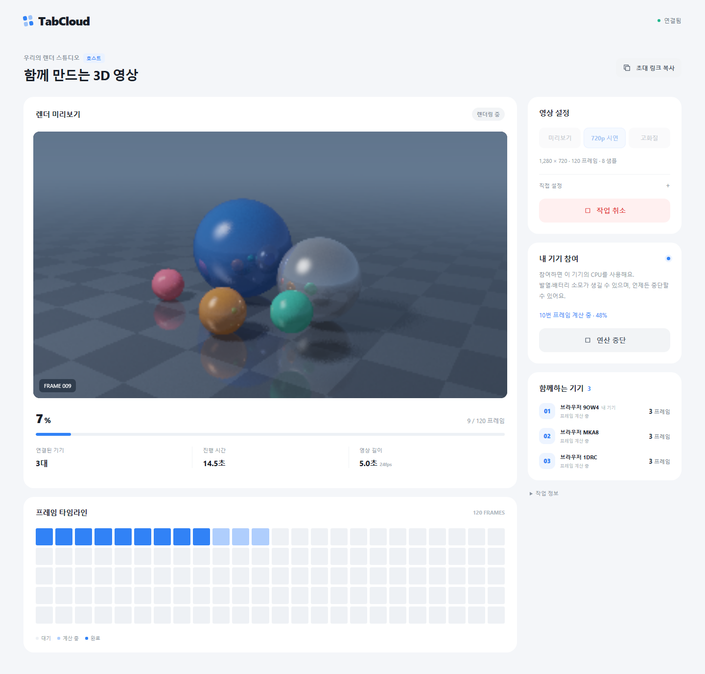

# TabCloud — 브라우저 엣지 렌더팜

링크로 연결한 브라우저들이 **3D 애니메이션의 서로 다른 프레임을 CPU Web Worker에서 렌더링**하고, 서버가 받은 프레임을 **재생 가능한 MP4 영상**으로 묶는 MVP입니다. 반사·그림자·샘플링을 실제로 계산하며, 명시적으로 **연산 참여**를 누르기 전에는 계산하지 않습니다. 기존 프랙털 데모는 `/fractal`에 보존했습니다.



[실제로 렌더링한 720p·5초 MP4](docs/assets/tabcloud-720p-demo.mp4) · [동일 PC의 브라우저 3개 실행 기록](docs/assets/animation-measurements.json)

## 빠른 시작

Node.js 24 LTS 권장(최소 22.13), pnpm 9.15.9, 최신 브라우저가 필요합니다. FFmpeg 실행 파일은 `ffmpeg-static` 의존성 설치 시 내려받습니다. 영상 프레임용 임시 디스크 공간도 필요합니다. Docker 실행에는 Docker Engine/Desktop 및 Compose 2.24 이상이 필요합니다.

```sh
npm install --global pnpm@9.15.9
pnpm install --frozen-lockfile
pnpm dev
```

브라우저에서 **http://localhost:5173**에 접속하세요. Vite 웹과 Fastify API(기본 3001)가 함께 시작되며, `/api`, `/ws`, `/healthz`는 개발 프록시를 사용합니다. 개발 서버에서도 요청의 원래 Host를 보존해 출처 검사를 통과합니다. 서버 설정을 바꾸려면 `.env.example`을 `.env`로 복사하세요(PowerShell: `Copy-Item .env.example .env`, macOS/Linux: `cp .env.example .env`). `.env`가 없어도 기본값으로 실행됩니다.

프로덕션 빌드는 동일한 출처에서 웹·API·WebSocket을 제공합니다.

```sh
pnpm build
pnpm start
```

접속 주소: **http://localhost:3001**. 상태 확인: `/healthz`.

## 사용 순서

1. **방 만들기**를 누르고 **미리보기 / 720p 시연 / 고화질** 중 하나를 선택합니다. 기본값은 **1280×720·120프레임·24fps·8샘플**, 5초짜리 영상입니다. 고화질은 10초·16샘플입니다. 해상도·프레임·샘플·반사 수는 **직접 설정**에서 조절합니다.
2. 초대 링크를 다른 두 브라우저에 전달합니다. 참여자는 작업 설명과 CPU·배터리 안내를 읽고 **연산 참여**를 누릅니다. 방장은 관찰만 하거나 직접 연산할 수 있습니다.
3. 방장이 **렌더 시작**을 누르면 동의한 브라우저가 프레임을 가져갑니다. 실제 완료 프레임과 기기별 기여도, 마지막 완성 프레임의 미리보기가 갱신됩니다.
4. 참여자의 **연산 중단** 또는 탭 종료 시 미완료 프레임을 재배정합니다. 방장의 **작업 취소**는 전체 작업을 중단합니다.
5. 모든 프레임이 모이면 서버가 MP4로 인코딩합니다. 완료 영상을 재생하고 **영상 다운로드**를 누릅니다. 화면에서 렌더·인코딩·전체 시간을 구분해 확인합니다.

동일 컴퓨터에서는 시크릿 창이나 별도 브라우저 프로필을 사용하면 역할이 확실히 분리됩니다. 물리적 기기에서 테스트하려면 `localhost` 대신 서버의 LAN 주소로 처음부터 접속해 방을 만드세요. 예: `http://192.168.0.10:5173`. 방화벽은 사용자가 허용한 사설 네트워크에서만 해당 포트를 개방하세요.

## 구현 범위

영상 모드의 자세한 구조, 실제 기기 시연, 성능 비교 절차는 [영상 렌더팜 가이드](docs/ANIMATION.md)에 있습니다.

- CPU 3D 레이트레이싱: 금속 구체, 바닥 반사, 움직이는 카메라·조명·물체, 샘플링
- 독립 프레임 분배, 명시적 참여·즉시 중단, heartbeat·lease·재시도·중복 거절
- 프레임별 바이너리 업로드·표본 재검산·PPM 디스크 저장, 작은 PNG 미리보기
- 서버의 제한된 FFmpeg 인코딩, H.264 MP4 재생·다운로드, 취소·만료 시 파일 정리
- 720p·최대 240프레임·32샘플·4회 반사, Worker 1개/브라우저

기존 프랙털 모드(`/fractal`)도 다음 기능과 함께 유지합니다.

- 추측하기 어려운 방 ID·초대 토큰, 별도 방장 토큰, 만료·가명 참가자·실시간 상태
- 결정적 Mandelbrot 엔진, 부분 경계 타일, 실제 Worker 1개/브라우저, Canvas 합성과 PNG
- 명시적 참여·즉시 중단, pull 방식 작업 배정, heartbeat·진행 보고·lease·attempt ID
- 이탈·타임아웃 재배정, 중복·오래된 결과 거절, 재시도 한도와 실패·취소 상태
- 타일당 최대 8개 픽셀 서버 재검산, 버퍼 길이·입력 범위·권한·메시지 제한
- 완료 결과 재전송, 새로고침·재연결 후 재동의, 만료·서버 재시작 안내
- 같은 엔진의 단독 실행, 결과 체크섬 비교, 완료 시간·기여도·검증 시간·전송량 계측
- 반응형 한국어 UI, Docker, Vitest, Playwright, GitHub Actions

| 위치 | 역할 |
| --- | --- |
| `apps/web` | 영상·프랙털 React 화면, 실제 Web Worker, 프레임·영상 미리보기 |
| `apps/server` | Fastify API·정적 파일·WebSocket, 작업 관리·프레임 저장·MP4 인코딩 |
| `packages/shared` | 영상·프랙털 타입, 엄격한 Zod 검증, 공통 제한 |
| `packages/compute` | 결정적 3D 레이트레이서와 Mandelbrot 엔진 |
| `tests/e2e` | 독립 Chromium 컨텍스트와 실제 Worker 기능 테스트 |
| `docs` | 아키텍처·시연·배포·실제 검증 결과 |

## 검증 명령

```sh
pnpm lint
pnpm test
pnpm build
pnpm exec playwright install chromium
pnpm test:e2e
```

`pnpm lint`는 ESLint와 전체 TypeScript 검사를 수행합니다. `pnpm test`는 계산·스키마·실제 로컬 WebSocket 서버 통합 테스트를 실행합니다. `pnpm test:e2e`는 **먼저 빌드한** 정적 앱을 사용하며, 필요하면 서버를 자동으로 실행합니다. 실패 시 `playwright-report/` 및 `test-results/`에 trace·스크린샷을 저장합니다. `pnpm check`로 전체 검증을 순서대로 실행할 수 있습니다. CI도 같은 흐름과 Docker 빌드를 실행하도록 구성했습니다.

E2E는 방장과 참여자 두 명의 독립 컨텍스트에서 실제 Worker 실행·각 기여도·전체 픽셀 일치·MP4 재생과 다운로드·동의·중단·이탈 복구·취소를 확인합니다. 지연된 응답과 업로드 재시도도 확인하며, 기존 프랙털의 PNG·단독 측정 검증을 유지합니다. **동일 머신의 컨텍스트 테스트는 물리적 기기 3대의 성능 실험이 아닙니다.** 실제 실행한 명령과 결과는 [검증 기록](docs/VALIDATION.md)에 있습니다. GitHub 원격 CI 실행은 이 로컬 검증과 별개입니다.

이미 실행한 로컬 테스트 컨테이너를 검증하려면 `E2E_BASE_URL=http://127.0.0.1:3003` 환경변수를 설정한 뒤 `pnpm test:e2e`를 실행할 수 있습니다. 이 경우 테스트는 서버를 따로 시작하지 않으며 해당 서버에 임시 방과 연산을 생성합니다.

## Docker

```sh
docker compose up --build -d
docker compose logs -f tabcloud
docker compose down
```

접속 주소는 **http://localhost:3001**입니다. `.env`가 있으면 운영 제한을 컨테이너에 전달합니다. Compose의 `PORT`는 외부 포트이고 컨테이너 내부는 항상 3001입니다. HTTPS 배포에서는 `PUBLIC_ORIGIN=https://실제도메인`을 설정하고 TLS 리버스 프록시를 사용하세요. 자세한 명령과 Caddy 예시는 [배포 가이드](docs/DEPLOYMENT.md)에 있습니다.

## 프랙털 모드 운영 기본값과 제한

영상 모드는 [별도의 디스크·프레임 제한과 처리 흐름](docs/ANIMATION.md)을 사용합니다. 아래 표는 기존 프랙털 모드의 값입니다.

| 항목 | 기본값 |
| --- | --- |
| 이미지/연산 | 64..2048px 각 변, 최대 4,194,304픽셀, 10..20000회 반복 |
| 타일/브라우저 | 32·64·128px, 최대 4096타일, Worker/활성 lease 각 1개 |
| 방/참가자 | 서버 32방, 방당 연결 24명, 참여 기록 64명 |
| 방 보존 | 생성 후 1시간, 빈 방 10분 후 정리 |
| 연결/작업 시간 | heartbeat 20초, lease 15초, attempt 최대 120초, 작업 10분 |
| 재시도 | 최초 시도 외 5회 재시도; 초과 시 전체 작업 실패 |
| 메시지 | 96KiB, 연결당 초당 250개, 방 생성 IP당 분당 10개 |
| 저장 예산 | 작업당 24MiB, 서버 전체 128MiB 예약, 송신 대기 2MiB |

실제 Worker의 증가하는 행 진행 보고만 lease를 연장합니다. heartbeat는 연결 확인용으로 계산 완료를 대신하지 않습니다. 최대 attempt 시간 이후에는 재배정합니다. 결과는 다음 작업·방 만료·빈 방 정리까지 보관해 다운로드와 재접속을 지원합니다. 한도 내 입력도 조합과 서버 잔여 예산에 따라 거절될 수 있습니다. 예를 들어 2048²/32px 타일은 기본 작업 메모리 예산을 넘으므로 64px 이상 타일을 사용하세요. 메모리 예산은 결과와 메타데이터의 예약치로 Node 프로세스 전체 RSS 제한과 동일하지 않습니다.

시연용은 기존 1024²/500회보다 픽셀 수가 4배, 반복 상한이 16배입니다. 이는 최대 연산 예산 비교이며 실제 소요 시간이 64배라는 의미는 아닙니다. **최대 부하**는 2048²/20,000회, **가볍게**는 1024²/500회입니다. 모든 모드에서 Worker 1개와 명시적 참여·중단 정책은 동일하며 인위적으로 대기 시간을 늘리지 않습니다. 상세 로그는 **활동 기록**, 체크섬·계측 설명은 **측정 정보**에서 펼쳐 볼 수 있습니다.

## 정확성·신뢰·개인정보

실행할 코드는 내장 3D 장면과 Mandelbrot 엔진으로 고정되어 있습니다. 임의 코드 업로드·사용자 파일·카메라·마이크·계정 기능은 없습니다. 초대 토큰은 URL fragment에, 방장 토큰은 해당 탭의 `sessionStorage`에 저장합니다. 방장 토큰은 초대 링크에 포함하지 않습니다. 동일 탭 새로고침 시 유지되지만 닫으면 관리 권한 복구를 보장하지 않습니다. 탭 복제 시 브라우저가 세션 저장소를 복사할 수 있으므로 방장 탭 자체를 타인에게 넘기지 마세요. 초대 링크를 가진 사람은 방과 결과를 볼 수 있습니다.

브라우저는 신뢰할 수 없는 노드입니다. 표본 검증은 일반 오류 탐지이며 악의적인 결과의 전체 무결성을 보장하지 않습니다. UI FNV-1a 체크섬은 비교용이며 암호학적 증명이 아닙니다. 자동화는 기준 렌더와 전체 RGBA 바이트를 비교합니다. HTTP 서버 로그에는 IP·경로 등 운영 정보가 남을 수 있고, 프록시 로그 보존은 운영자가 정합니다.

공개 배포에는 HTTPS/WSS가 필요합니다. 서버는 origin 검사, 보안 헤더, 입력·권한·빈도·메모리 제한을 적용합니다. API의 IP 제한은 기본적으로 프록시를 신뢰하지 않으므로 역방향 프록시 뒤에서는 프록시 IP를 함께 제한할 수 있습니다. 외부 공개 서비스의 인증·참가자 차단·DDoS 방어·영속 저장·다중 서버 운영은 MVP 범위 밖입니다.

서버 재시작 시 모든 방과 결과가 사라집니다. 브라우저마다 Worker 실행과 백그라운드 타이머 정책이 다르며 숨김·절전 시 느려지거나 lease가 만료될 수 있습니다. 정확한 CPU 사용률은 강제하지 않습니다. 자동 브라우저 검증은 Chromium에서 수행했으며 Safari·Firefox의 모든 버전을 검증한 것은 아닙니다.

## 시간 측정의 의미

영상 모드는 서버의 렌더·인코딩·전체 시간을 구분합니다. 전체 시간은 시작부터 MP4 파일 완성까지이며, 브라우저 다운로드·재생 시간은 포함하지 않습니다. 아래의 단독 측정 버튼과 체크섬 비교 설명은 프랙털 모드에 해당합니다.

분산 비교 시간은 방장 브라우저에서 **시작 클릭→전체 타일 합성 후 화면 프레임**을 `performance.now()`로 측정합니다. 새로고침·재연결 시 이 기준값은 폐기하며 속도 비율을 만들지 않습니다. 서버의 **시작→전체 결과 승인** 시간도 따로 표시합니다. 단독 실행은 같은 설정과 Worker 1개로 초기화·계산·캔버스 합성을 포함합니다. 작업 완료 후 비교하므로 다른 분산 작업과 CPU를 중복 점유하지 않습니다.

`단독 시간 / 분산 시간`은 실측값이 모두 있을 때만 표시합니다. 할당→결과 수신 시간 합계는 여러 기기에서 겹치고 계산·대기 시간을 포함하므로 순수 통신 오버헤드가 아닙니다. Worker 시간은 클라이언트 보고값이며 행 단위 양보 시간도 포함합니다. 작은 작업은 분산 쪽이 더 느릴 수 있습니다. 성능 향상 수치는 보장하지 않습니다.

[아키텍처](docs/ARCHITECTURE.md) · [기기 3대 시연](docs/DEMO.md) · [배포](docs/DEPLOYMENT.md) · [실행 검증 기록](docs/VALIDATION.md)

TabCloud 자체 소스는 MIT License입니다. 의존하는 FFmpeg 실행 파일에는 해당 빌드의 라이선스가 적용됩니다. 요구사항 원문은 `TabCloud_Documents/`에 보존했습니다.
