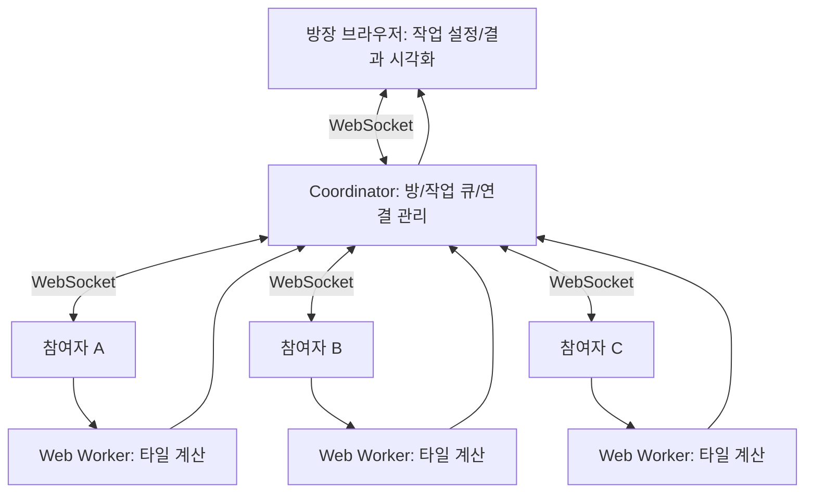

# TabCloud 프로젝트 개요서

> **Your Browser. Our Supercomputer.**  
> 웹 브라우저 기반 협업형 분산 컴퓨팅 플랫폼

- **프로젝트명:** TabCloud
- **초기 제품명:** TabCloud Render
- **유형:** 웹 기반 오픈소스 분산 컴퓨팅 프로젝트
- **목표:** 설치 없이 링크로 참여자를 모아 브라우저에서 독립적인 계산을 나누어 수행하고 결과를 통합한다.
- **주요 기술:** TypeScript, React, WebSocket, Web Workers, Node.js, Docker
- **후속 확장 기술:** WebAssembly, WebRTC, 개발자 SDK
- **예상 MVP 개발 기간:** 약 6~8주(웹 개발 경험이 있는 1인 개발자, 주 10~15시간 가정)
- **예상 공개 방식:** GitHub 오픈소스 + 체험용 웹사이트 + Docker 자체 호스팅

---

## 1. 프로젝트 개요

**TabCloud는 여러 사용자가 브라우저에 접속하여 자발적으로 자신의 연산 자원을 공유하고, 하나의 대규모 계산 작업을 공동으로 처리하는 플랫폼이다.**

사용자가 연산방을 만들고 초대 링크를 공유하면 다른 사용자는 별도 프로그램 설치 없이 참여할 수 있다. 각 참여자의 브라우저는 자신에게 배정된 계산을 수행하고 결과를 돌려준다. 중앙 서버는 연산방, 작업 분배, 연결 상태, 재시도 및 결과 전달만 조율한다.

첫 제품인 **TabCloud Render**에서는 프랙털 이미지를 여러 타일로 분할해 공동 렌더링한다. 이후 시뮬레이션·매개변수 탐색·생성형 아트 등 **작업을 독립적으로 분할할 수 있는 분야**로 확장한다.

### 핵심 사용자 경험

1. 웹사이트에서 `연산방 만들기`를 누른다.
2. 프랙털 해상도·반복 횟수 같은 작업 설정을 선택한다.
3. 생성된 초대 링크를 다른 사람에게 보낸다.
4. 참여자가 작업 내용과 자원 사용에 동의하고 `연산 참여`를 누른다.
5. 각 브라우저가 서로 다른 타일을 계산하고, 작업 완료에 따라 이미지가 실시간으로 채워진다.
6. 누군가 탭을 닫아도 미완료 작업이 다른 참여자에게 재할당된다.
7. 완성된 이미지를 다운로드하고 단독 실행 대비 처리 시간을 비교한다.

## 2. 추진 배경과 해결하려는 문제

### 2.1 개인 컴퓨터의 계산 성능 한계

고해상도 프랙털 생성, 매개변수 조합 탐색, 반복적인 몬테카를로 계산 등은 한 컴퓨터에서 오래 걸릴 수 있다. 클라우드 VM이나 전문 렌더팜을 이용할 수 있지만 작업 환경 구성과 비용이 진입 장벽이 될 수 있다.

### 2.2 분산 컴퓨팅 도구의 진입 장벽

기존 분산 연산 도구에는 설치, 노드 구성, 작업 제출 형식, 런타임 관리 등을 이해해야 하는 경우가 있다. TabCloud는 **미리 지원하는 작업에 한해** 이러한 복잡함을 링크 기반의 간단한 사용 경험으로 줄이고자 한다.

### 2.3 공동 작업의 잠재력

이미 함께 모여 있는 학급, 연구팀, 창작자 그룹의 기기를 **명시적인 동의 아래** 일시적으로 묶는다면 별도의 장기 운영 클러스터 없이 분산 처리와 협업을 경험할 수 있다.

> **중요한 전제:** TabCloud가 AWS 같은 전문 클라우드를 완전히 대체하거나 어떤 프로그램이든 자동으로 분산 실행하는 것은 아니다. 데이터 전송량이 작고 독립적인 계산 단위가 많은 작업에 적합하다. 여러 기기를 연결한다고 항상 빨라지는 것도 아니다.

## 3. 프로젝트 목표

1. **쉬운 참여:** 프로그램 설치나 회원가입 없이 링크와 동의만으로 연산 참여.
2. **진짜 분산 실행:** 서로 다른 물리적 컴퓨터의 브라우저가 실제로 다른 계산 단위를 처리.
3. **동적 스케줄링:** 빨리 끝내는 기기가 다음 작업을 가져가는 방식으로 작업 배분.
4. **장애 복구:** 브라우저 종료·연결 해제·타임아웃 때 미완료 작업 재할당.
5. **시각적 결과:** 참여 기기, 담당 작업, 이미지 완성 과정, 기여도 실시간 표시.
6. **정확성:** 단독 실행과 분산 실행 결과가 동일하도록 결정적 연산 및 결과 검사.
7. **객관적 측정:** 단독 실행과 분산 실행의 실제 소요 시간 및 통신 오버헤드 비교.
8. **확장성:** 후속 버전에서 검증된 연산 템플릿과 SDK를 추가할 수 있는 구조.

## 4. 예상 사용자와 실제 사용 사례

| 대상 사용자 | 실제로 할 작업 | 제공 가치 | 우선순위 |
|---|---|---|---|
| 생성형 아트 개발자·창작자 | 프랙털 및 매개변수별 이미지 대량 생성 | 공동 렌더링과 즉시 보이는 결과 | 높음 |
| 대학교수·학생 | 분산 처리·몬테카를로 시뮬레이션 실습 | 별도 클러스터 설정 없는 교육 도구 | 높음 |
| 소규모 연구팀 | 독립적인 실험 조건 수천 개 계산 | 팀원 기기를 활용한 임시 배치 처리 | 중간·SDK 필요 |
| 해커톤 팀·개인 개발자 | 알고리즘 병렬화·분산 시스템 실험 | 스케줄링과 장애 복구를 쉽게 관찰 | 중간 |

### 대표 사례 A: 협업형 프랙털 렌더링

한 사용자가 고해상도 프랙털을 생성하려고 한다. 계산 영역을 타일로 쪼개 참여 브라우저에 분배하고, 완료된 타일을 화면에서 즉시 합친다. 사용자별 담당 영역을 표시하며 중간 이탈 시 작업을 자동 재배정한다.

### 대표 사례 B: 클라우드 컴퓨팅 실습

교수자가 실습방과 QR코드를 제공한다. 학생들은 브라우저에서 계산 참여에 동의하고 각자의 연산 결과를 전체 결과에 반영한다. 참여 수, 작업 처리량, 네트워크 오버헤드, 장애 복구 과정을 교실에서 함께 관찰한다.

### 대표 사례 C: 반복 시뮬레이션(후속 확장)

같은 알고리즘의 서로 다른 난수 시드 또는 매개변수 조합을 독립적으로 계산한다. 실행 조건과 결과를 함께 기록하여 CSV 등으로 내보낸다. 이 기능은 **MVP에서 제외**하고 2차 버전에서 구현한다.

## 5. 핵심 기능

### 5.1 Instant Compute Room

- 방 생성, 만료, 고유 초대 링크, 방장과 참여자의 역할 구분
- 참여자별 상태(대기·계산 중·연결 종료) 표시
- 로그인 없는 소규모 협업을 우선 지원

### 5.2 Distributed Task Engine

- 이미지를 독립적인 타일 작업으로 분할
- 작업 ID를 부여하고 참여자 브라우저의 Web Worker로 전송
- 계산 결과를 수집해 하나의 이미지로 병합
- 서버는 조정 역할, 실제 고비용 픽셀 계산은 참여 브라우저에서 실행

### 5.3 Adaptive Scheduling

- 작업 완료 후 다음 작업을 요청하는 pull 기반 할당
- 기기별 완료 속도를 관찰해 느린 참여자로 인한 대기 최소화
- 최초 MVP는 복잡한 AI 스케줄러 대신 신뢰 가능한 작업 큐 채택

### 5.4 Fault Recovery

- 연결 끊김·작업 기한 만료 감지
- 미완료 작업 재할당
- 늦게 도착한 오래된 결과·중복 결과가 최종 이미지에 두 번 반영되지 않도록 처리

### 5.5 Live Compute Dashboard

- 참여 기기 수, 작업 진행률, 참여자별 처리량
- 완성되는 이미지 캔버스, 오류 및 재시도 상태
- 최종 PNG 다운로드
- 동일 설정 기준 단독 실행과 분산 실행의 시간 비교

### 5.6 Safe Computing

- **명시적인 참여 동의**, 언제든 중단 가능한 UI
- 초기에는 **사전에 내장한 계산 코드만 실행**, 임의 코드 업로드 금지
- 작업 크기·동시 실행 수·방 인원·서버 메시지 크기 제한
- 민감한 파일 및 개인 데이터를 다른 참여자의 브라우저에 보내지 않음
- 일부 결과 재검산 또는 표본 검증을 통한 오작동 탐지(초기에는 간단한 검증부터)

### 5.7 Speed Judge(후속 기능)

짧은 샘플 계산과 통신 시간을 측정하여 분산 실행이 실제로 유리할지 알려주는 기능. **초기 MVP의 필수 기능은 아님.**

## 6. 시스템 아키텍처

**역할 분담**

- **React 웹 UI:** 방 생성/참여, 동의, 실시간 진행률, 이미지 출력, 결과 다운로드.
- **Coordinator(Node.js):** 작업 분할, 유효한 연결 관리, 작업 할당/기한, 재시도, 결과 수집 및 상태 발행.
- **Browser Worker:** 독립적인 타일 픽셀 계산. 메인 UI 스레드와 분리.
- **결과 처리:** 동일 task ID의 결과를 한 번만 반영하고 누락 없는지 확인.

초기에는 중앙 서버를 이용한 WebSocket 통신으로 단순성을 유지한다. WebRTC 직접 연결, 다중 Coordinator, 분산 저장소는 이후 버전에서 고려한다.

## 7. 기술 스택

| 영역 | 초기 기술 | 비고 |
|---|---|---|
| 프런트엔드 | React + TypeScript + Vite | 브라우저 UI |
| 백엔드 | Node.js + TypeScript + Fastify | 방과 작업 큐 조정 |
| 통신 | WebSocket | 양방향 실시간 메시지 |
| 브라우저 연산 | Web Workers | UI와 계산 분리 |
| 작업 형식·검증 | 공용 TypeScript 타입·런타임 스키마 | 프런트와 서버 규약 일치 |
| 저장 | 초기 메모리 내 세션 | 서버 재시작 시 방 소멸(제한사항 고지) |
| 이미지 출력 | Canvas API / PNG | 타일 결과 통합 |
| 테스트 | 단위/통합 테스트 + Playwright | 실제 브라우저 동작 검증 |
| 배포 | Docker, 단일 소형 VPS | 동일 출처 HTTP/HTTPS + WS/WSS |
| 후속 확장 | WebAssembly, WebRTC, Redis | MVP 범위 밖 |

## 8. 기존 방식과 차별점

| 구분 | 기존 방식의 장점 | TabCloud의 목표 |
|---|---|---|
| 로컬 PC 실행 | 단순하고 네트워크 오버헤드 없음 | 자발적으로 참여한 다른 기기의 연산 자원 활용 |
| 클라우드 VM·렌더팜 | 예측 가능한 성능과 확장성 | 작은 팀을 위한 낮은 시작 장벽 |
| BOINC 등 자원봉사 컴퓨팅 | 장기간·대규모 계산 운영 | 링크 하나로 짧게 진행하는 일회성 공동 연산 |
| Pando·Wasimoff 등 브라우저 분산 컴퓨팅 | 브라우저 연산 분산의 선행 구현 | 작업 템플릿·즉석 방·결과 시각화 중심의 제품 경험 |

**차별화의 핵심은 분산 처리 기술을 처음 발명했다는 주장이 아니다.** 누구나 즉시 이해할 수 있는 워크플로와 공동 작업 경험을 제공하고, 실제 속도·정확도·이탈 복구로 효과를 검증하는 것이다.

## 9. MVP 범위

### 반드시 구현할 항목

1. 방 생성/초대 링크/방장과 참여자 구분
2. 참여 동의, 참여 중단, 현재 연결 상태 표시
3. 프랙털(Mandelbrot) 설정 및 타일 작업 분할
4. 서로 다른 브라우저에서 실제 Web Worker 계산
5. 완료 시 새 작업을 요청하는 동적 스케줄링
6. 중단·연결 해제·타임아웃 시 작업 재할당
7. 중복 결과 반영 방지 및 최종 이미지 정확성 확인
8. 진행률/참여자별 작업 수/결과 이미지 표시
9. 완성된 PNG 다운로드
10. 단독 실행 대비 분산 실행의 소요 시간 측정
11. Docker 기반 실행, README, 샘플 시연 및 자동화 테스트

### 초기 버전에서 제외

- 불특정 사용자가 제출한 임의 JS·Python·WASM 코드 실행
- 범용 머신러닝 학습, Blender 전체 워크플로, GPU 렌더팜
- 서버 없는 완전 P2P 네트워크, 암호화폐·토큰 보상
- 과도하게 복잡한 회원/결제/마켓플레이스 시스템
- 여러 서버 간 무중단 방 이동과 장기 작업 저장

## 10. 대표 시연 시나리오

**목표:** 서로 다른 물리적 컴퓨터 세 대로 고해상도 프랙털 이미지 하나를 계산한다.

1. 방장이 작업방을 열어 프랙털 해상도와 반복 횟수를 설정한다.
2. 다른 두 기기가 초대 링크로 접속하고 연산 참여를 승인한다.
3. 작업을 시작하면 각 브라우저가 서로 다른 타일을 실제로 계산한다.
4. 캔버스가 타일별로 실시간 완성되고 참여자별 작업 수가 갱신된다.
5. 한 기기에서 브라우저 탭을 닫아 연결을 끊는다.
6. 작업 관리 서버가 해당 기기의 미완료 타일을 재배정한다.
7. 이미지가 누락 없이 완성되어 PNG로 다운로드된다.
8. 동일한 조건의 단독 실행 측정값과 전체 소요 시간을 비교한다.

> 다중 브라우저 탭을 한 기기에서 실행하는 기능 테스트와, 실제 물리적 기기를 연결하는 성능 벤치마크는 구분한다.

## 11. 개발 일정(안)

| 기간 | 목표 | 주요 산출물 |
|---|---|---|
| 1주 차 | 저장소 구조·방·WebSocket | 연결 가능한 연산방 |
| 2주 차 | 타일 분할·Web Worker 연산 | 실제 분산 렌더링 |
| 3주 차 | 작업 큐·동적 할당 | 이기종 기기 작업 처리 |
| 4주 차 | 타임아웃·이탈 복구 | 재할당·중복 방지 |
| 5주 차 | UI·캔버스·PNG 다운로드 | 완성된 사용자 화면 |
| 6주 차 | 정확성·성능 평가 | 실측 벤치마크 결과 |
| 7주 차 | 안전성·예외 처리·사용성 | 제한과 복구 정책 |
| 8주 차 | Docker·문서·배포 | OSS 공개 가능한 MVP |

일정은 목표치일 뿐 보장되지 않는다.

## 12. 기술적 위험과 대응

| 위험 | 영향 | 대응 |
|---|---|---|
| 네트워크/분배 오버헤드가 큼 | 로컬 실행보다 느려질 수 있음 | 계산량이 큰 작업 선택, 실측 및 비교 |
| 참여자의 탭 종료·기기 절전 | 작업 중단 | heartbeat, lease, 재할당 |
| 느리거나 잘못된 결과 반환 | 완료 지연·이미지 오류 | 타임아웃, 표본 검증, 중복 결과 제거 |
| 브라우저 CPU 과다 사용 | 발열·사용자 불편 | 참여 동의, Worker 수 제한, 언제든 중지 |
| 작업·방 남용 | 서버 자원 고갈 | 할당량, 만료, 메시지 제한, 속도 제한 |
| 무단 참여·방장 권한 탈취 | 작업 통제권 혼란 | 추측하기 어려운 방/초대값, 별도 방장 권한 |
| 서버 재시작 | 인메모리 세션 유실 | MVP 제한 명시, 후속 저장소 도입 |

브라우저에서 CPU 점유율을 정확하게 보장·강제하기 어렵다. MVP에서는 동시 Worker 수와 작업 실행 시간을 제한하고 즉시 중단 기능을 제공한다.

## 13. MVP 성공 판정 기준

| 항목 | 목표 또는 판정 방법 |
|---|---|
| 접근성 | 로그인·설치 없이 링크로 참여 가능 |
| 참여자 | 서로 다른 물리적 기기 3대 이상 실험 |
| 실제 분산 연산 | 참여 기기들이 서로 다른 타일을 계산했다는 기록 확보 |
| 계산 정확성 | 기준 단독 결과와 픽셀/체크섬 일치 |
| 이탈 복구 | 참여자 1명 이탈 후 남은 기기로 최종 작업 완료 |
| 무결성 | 오래된 결과와 중복 결과가 두 번 적용되지 않음 |
| 비교 측정 | 같은 설정에서 단독/분산 실행 wall-clock 시간 기록 |
| 성능 목표 | 적합한 작업에서 **1.5배 이상 속도 향상 도전**(보장 아님) |
| 운영 | README 지침으로 실행 및 Docker 배포 가능 |
| 안전성 | 명시적 참여·중단, 임의 코드 실행 금지, 기본 남용 제한 |

속도는 네트워크와 기기 성능에 따라 달라지므로 성공 여부를 임의의 성능 수치로 포장하지 않는다. 기대보다 느리면 원인과 계측 결과를 명확히 공개한다.

## 14. 후속 발전 로드맵

- **TabCloud Render (1.0):** 프랙털 공동 렌더링, 링크 기반 임시 연산방, 이탈 복구, 속도 비교.
- **TabCloud Lab (2.0):** 몬테카를로 시뮬레이션, 매개변수 탐색 등 검증된 템플릿 추가.
- **TabCloud SDK (3.0):** 개발자용 작업 분할·계산·결과 병합 인터페이스, 안전한 연산 모듈 등록 정책.
- **TabCloud Network (장기):** 신뢰도 높은 검증, 고급 스케줄링, 선택적 WebRTC 직접 통신, 확장형 운영.

## 15. 결론

TabCloud는 전문 클라우드 서비스를 대체하려는 프로젝트가 아니다. **모두가 이해할 수 있는 사용 경험으로 분산 컴퓨팅 기술을 일상적인 공동 작업에 연결**하는 것이 핵심이다.

최초 제품에서는 프랙털 렌더링이라는 눈에 보이는 문제 하나를 끝까지 해결한다. 이후 실제 사용자 수요와 성능 검증에 따라 교육·창작·연구를 위한 계산 템플릿 및 개발자 SDK로 확장한다.

**제품의 한 줄 목표:** *링크 하나로 컴퓨팅 자원을 모아, 혼자 오래 걸리는 작업을 함께 완성한다.*
