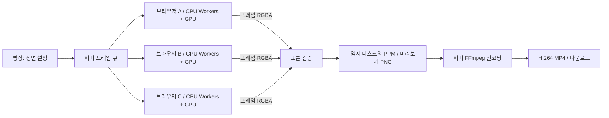

# TabCloud 브라우저 엣지 렌더팜

여러 브라우저가 내장 3D 장면의 서로 다른 프레임을 CPU Web Workers와 WebGPU로 계산한다. 각 기기는 자신에게 배정된 프레임을 작은 행 구간으로 나눠 설정한 자원 한도 안에서 실행한다. 서버는 방·작업 배정·표본 검증·프레임 저장·최종 MP4 인코딩을 담당한다. 입력은 작은 장면 설정과 프레임 번호이며, 사용자 동영상 업로드나 임의 프로그램 실행은 지원하지 않는다.

## 실행과 시연

`pnpm install --frozen-lockfile` 후 `pnpm dev`를 실행하고 `http://localhost:5173`에서 방을 만든다. 영상 인코더 `ffmpeg-static`은 의존성 설치 시 운영체제에 맞는 실행 파일을 내려받는다. 별도 FFmpeg를 사용할 때는 서버의 `FFMPEG_PATH`를 해당 실행 파일의 절대 경로로 지정한다.

1. **미리보기**로 설치와 영상 재생을 먼저 확인한다.
2. **720p 시연**을 선택하고 초대 링크를 다른 기기에 연다. CPU만 쓰는 LAN 시연에서는 처음부터 서버의 LAN 주소로 방을 만든다. `localhost` 링크는 다른 기기를 가리키지 않는다. GPU 시연은 HTTPS 주소를 사용한다.
3. 각 기기의 **내 기기 자원**에서 CPU·GPU·RAM 비율을 정한다. **연산 참여**를 누르고 방장에서 **렌더 시작**을 누른다. 방장은 관찰만 할 수도 있다.
4. 완료 프레임과 기기별 기여도를 확인한다. 작업 중 한 기기의 **연산 중단** 또는 탭 종료로 재배정을 시연한다.
5. 프레임 렌더링 후 서버 인코딩이 끝나면 완성 영상을 재생하고 **영상 다운로드**로 MP4를 저장한다.

| 프리셋 | 해상도 | 프레임 / 길이 | 픽셀당 샘플 | 반사 한도 |
| --- | --- | --- | --- | --- |
| 미리보기 | 320×180 | 24 / 1초 | 2 | 2 |
| 720p 시연 | 1280×720 | 120 / 5초 | 8 | 3 |
| 고화질 | 1280×720 | 240 / 10초 | 16 | 3 |

영상은 24fps다. 모든 프리셋은 실제 광선·교차·그림자·반사·샘플 계산으로 부하를 만들며 진행률은 실제 처리한 행과 승인된 프레임을 사용한다. **직접 설정**에서 해상도·프레임·샘플·반사 수를 변경할 수 있다. CPU·GPU의 설정 비율을 지키기 위한 휴식 시간을 두며 언제든 중단할 수 있다.

## 기기별 CPU·RAM·GPU 설정

기본값은 CPU 25%, GPU 0%, RAM 10%다. 설정은 `tabcloud:resource-limits:v1` 키로 해당 사이트의 `localStorage`에 저장한다. 다른 브라우저 프로필·기기의 설정과는 독립적이다. 같은 프로필의 탭은 저장값을 공유하지만 실행 중인 각 탭은 자신의 현재 한도를 적용하며 사용량이 합산된다. 비율 변경은 즉시 연산을 중단하고 서버 참여를 철회한다. 사용자가 **연산 참여**를 다시 눌러야 새 설정으로 계산한다.

| 자원 | 설정이 제어하는 값 | 제한 |
| --- | --- | --- |
| CPU | 논리 코어 수 × 설정 비율에 해당하는 Worker 수와 연산 시간 비율 | 최대 16개, 코어 수·행 구간 수·RAM 예산 이내 |
| RAM | 브라우저 용량 힌트 × 설정 비율로 얻은 렌더링 버퍼 예산 | 용량 미확인 시 512 MiB 기준, 최종 예산 최대 512 MiB |
| GPU | WebGPU 구간 처리 시간에 대한 연산·휴식 시간 비율 | 한 번에 최대 8행 구간 1개만 제출 |

CPU의 초기 Worker 수는 `ceil(논리 코어 수 × CPU% / 100)`이며 상한과 RAM 예산을 적용해 줄인다. 각 Worker의 duty cycle은 `min(1, 논리 코어 수 × CPU% / 100 / 실제 Worker 수)`다. 예를 들어 12개 논리 코어에서 CPU 25%는 Worker 3개를, CPU 5%는 Worker 1개를 약 60%의 연산 시간 비율로 실행한다. Worker는 측정한 계산 시간에 비례해 쉬고 마지막 구간의 휴식도 생략하지 않는다. CPU 행 청크는 약 8ms를 목표로 조절하지만 비싼 한 행은 더 오래 걸릴 수 있다.

RAM 용량은 `navigator.deviceMemory`의 대략적 힌트이며 실제 전체 용량이나 현재 여유 RAM이 아니다. 브라우저가 값을 제공하지 않으면 512 MiB 기준을 사용한다. 예를 들어 이 경우 RAM 10%의 예산은 약 51.2 MiB다. 계획에는 전체 RGBA 프레임·업로드·미리보기 여유분, CPU 구간 버퍼, Worker당 8 MiB의 여유분, GPU 저장·읽기·결과 버퍼가 포함된다. 예산이 작으면 CPU Worker 수를 줄이고 최소 작업 공간도 확보하지 못하면 참여를 막는다. 사용하지 않는 RAM을 비율만큼 채우지는 않는다. 이 예산은 브라우저·드라이버 전체 메모리나 OS 프로세스 RSS를 제한하지 않는다.

GPU는 WGSL compute shader로 CPU와 같은 장면·샘플·반사를 계산한다. 구간 처리 후 `처리 시간 × (1 / GPU 비율 - 1)`만큼 쉬며, 마지막 구간에도 적용한다. 처리 시간에는 GPU 제출·완료 대기·결과 읽기와 CPU 정밀도 보정이 포함되어 하드웨어 GPU 사용률 자체와 다르다. GPU 0%에서는 렌더링용 GPU 장치를 만들거나 계산을 제출하지 않는다. UI의 지원 확인은 어댑터 검색만 수행한다.

부동소수점 경계의 일부 픽셀은 CPU 기준 레이트레이서로 보정한다. 로컬 720p 검증에서는 전체 픽셀의 약 8–16%가 보정됐으며 장면·설정·어댑터에 따라 달라진다. GPU 제어·결과 읽기에도 CPU가 필요하다. 따라서 **CPU 0%는 CPU Worker 풀을 끄는 설정이며 OS의 CPU 사용량 0%를 뜻하지 않는다.** 해당 보정 시간은 별도 CPU Worker 시간에 포함되지 않고 GPU 처리 시간에 포함된다. GPU 정밀도가 부족해 프레임의 40%를 초과해 보정해야 하면 실패 처리한다.

WebGPU는 HTTPS 또는 `localhost`에서 지원 브라우저·드라이버·어댑터가 있어야 한다. `http://192.168.x.x` 같은 일반 LAN HTTP에서는 CPU 모드를 사용한다. 소프트웨어 WebGPU 어댑터는 엔진 이름에 **WebGPU 소프트웨어**로 표시한다. 이는 물리 GPU 가속의 증거가 아니다. GPU 초기화가 실패하면 이미 허용한 CPU 범위 안에서만 계속하며, CPU 0%라면 오류를 표시한다. 실행 중 GPU 장치 유실 등은 부분 결과를 폐기하고 참여를 중단한다. CPU 한도는 자동으로 높이지 않는다.

설정 비율은 이 렌더러의 연산 시간·동시 실행·버퍼를 제어하는 상한이다. 작업이 작거나 통신·브라우저 스케줄링·RAM 제한이 있으면 그 비율만큼 사용하지 못할 수 있다. OS 전체 CPU·GPU 사용률을 정확히 측정하거나 고정하는 기능은 아니다. 이 설정은 영상 모드에만 적용하며 기존 프랙털 모드는 Worker 1개 정책을 유지한다.

## 계산과 저장 흐름

프레임 단위 pull 배정으로 빠른 기기가 더 많은 프레임을 처리한다. 기기 안에서도 CPU Workers와 GPU가 하나의 행 구간 큐에서 다음 작업을 가져가므로 더 빠른 연산 장치가 더 많은 구간을 처리한다. 느린 기기의 결과 품질을 낮추지 않으며 모든 구간은 같은 설정으로 계산한다. 각 서버 시도는 별도 attempt ID를 갖고, 승인된 프레임만 완료 수에 포함한다. 증가하는 행 진행 보고는 lease를 갱신하고, heartbeat는 기기의 연결 상태를 확인한다. 참여 철회·연결 유실·시간 초과로 회수된 프레임은 다른 참여자에게 배정된다.

장면·애니메이션 시간·픽셀·샘플 난수는 결정적으로 계산한다. CPU 구간을 합친 결과는 CPU 전체 프레임과 바이트 단위로 일치한다. WebGPU의 부동소수점 연산 차이는 보정 후 RGB 채널당 오차 1 이내를 검증한다. 서버는 전체 프레임을 대신 그리지 않고 소수 픽셀만 재계산하여 형식·시도·결과를 확인한다. 표본 검증은 악의적인 노드에 대한 완전한 무결성 증명이 아니다.

브라우저당 활성 프레임은 하나다. 조정 Worker가 하나의 전체 RGBA 버퍼에 제한된 CPU·GPU 구간 결과를 합치고 소유권을 UI에 이전해 바이너리로 업로드한다. 프레임 완료·오류·중단 시 CPU Workers와 GPU 자원을 정리한다. 서버는 결과를 PPM 파일로 저장하며 전체 영상을 RAM에 보관하거나 모든 참가자에게 방송하지 않는다. UI는 작은 PNG 미리보기와 작업 메타데이터만 갱신하고, 완료된 MP4를 요청한다. PPM·영상 파일은 새 작업, 취소, 방 정리, 정상 서버 종료에 맞춰 제거한다. 서버가 비정상 종료되면 OS 임시 경로에 잔여 파일이 남을 수 있다.

영상 저장소는 한 프로세스의 임시 디스크다. 최대 720p·240프레임, 동시에 렌더링·인코딩 중인 작업 2개, 완료 결과를 포함한 전체 예약 1500MiB 제한을 적용한다. 720p·240프레임의 RGB 본문은 약 664MB이며, 썸네일과 최종 영상 공간이 추가된다. 저장소 용량이 넉넉한 기기에서 시연한다. 이 예산은 프로세스 메모리 제한이나 장기 스토리지 서비스와 다르다. 작업 제한은 30분이며 영상 프레임의 시도 제한은 기본 10분(`ANIMATION_MAX_ATTEMPT_MS=600000`)이다. 자원 한도가 낮은 기기의 긴 프레임을 허용하되 실제 증가하는 진행 보고가 계속 필요하다. lease는 기본 15초, 연결 heartbeat 제한은 20초이며 프랙털의 시도 제한은 기존 120초를 유지한다.

매우 낮은 연산 한도, 느린 GPU·소프트웨어 어댑터, 백그라운드 탭의 타이머 제한에서는 다음 실제 진행 보고까지 15초를 넘겨 프레임이 재배정될 수 있다. 진행하지 않은 행 수를 반복 보고해 lease를 연장하지 않는다. 이런 환경에서는 영상 설정을 가볍게 하거나 사용자가 허용 범위를 조정해야 한다.

## 시간과 성능 해석

- 렌더 시간: 서버가 작업을 시작한 시점부터 마지막 프레임 승인까지. 참여자를 기다리는 시간과 전송도 포함한다.
- 인코딩 시간: 받은 프레임을 최종 MP4로 만드는 서버 단계.
- 전체 시간: 시작부터 영상 파일 완성까지. 다운로드와 사용자의 재생 대기는 포함하지 않는다.
- 기기 계산 시간 합계는 병렬 실행 구간이 겹치므로 전체 시간과 다르다.
- 자원 상세의 CPU 연산 누적은 CPU Workers의 실제 계산 구간 합계다. GPU 처리 시간은 GPU 제출부터 읽기·보정까지의 경과 시간이며 휴식은 제외한다. 두 값 모두 OS 사용률이 아니다.
- 서버로 보내는 프레임 `computeMs`는 Worker 시작부터 프레임 완료까지의 경과 시간으로, 초기화·병렬 계산·자원 한도를 위한 휴식을 포함한다.

한 기기와 여러 기기를 비교할 때는 해상도·프레임·샘플·반사 수를 동일하게 맞추고 두 경우 모두 최종 인코딩을 포함한다. 같은 PC의 여러 탭은 프로토콜·기여도 검증에 유용하지만 물리적 여러 기기의 가속률을 증명하지 않는다. 렌더가 가벼우면 네트워크·작업 요청·인코딩 비용 때문에 분산 쪽이 느릴 수 있다.

## 범위와 파일

기본 화면은 `/`, 영상 방은 `/studio/:id`다. 기존 프랙털은 `/fractal`과 `/room/:id`에 보존했다. 영상 모드의 API는 인증된 HTTP polling·바이너리 업로드로 동작하고, 기존 프랙털 모드의 WebSocket과 별도다. CPU만으로도 실행할 수 있으며 브라우저 WebCodecs는 요구하지 않는다. 서버 인코더가 MP4를 만들고 오디오는 없다.

- `packages/compute/src/animation.ts`: 내장 3D 렌더러
- `packages/shared/src/animation.ts`: 설정·프레임·상태 타입과 제한
- `apps/server/src/animation*.ts`: 작업 관리·인증·디스크·인코딩
- `apps/web/src/AnimationApp.tsx`, `ResourceControls.tsx`: UI·개인 자원 설정·참여 상태
- `apps/web/src/resource-budget.ts`, `resource-renderer.ts`: 예산 계산·기기 내부 작업 분배
- `apps/web/src/animation.worker.ts`, `cpu-render.worker.ts`: 조정 Worker·CPU 행 구간 Workers
- `apps/web/src/gpu-renderer.ts`, `gpu-shader.ts`: WebGPU 장면 계산·정밀도 보정·자원 정리
- `tests/e2e/animation.spec.ts`: 실제 다중 브라우저·MP4 테스트
- `tests/e2e/resources.spec.ts`: 자원 설정·저장·참여 철회·지연 응답 테스트
- `tests/e2e/gpu.spec.ts`, `gpu-integration.spec.ts`: 실제 WebGPU 픽셀·취소·CPU 혼합·MP4 테스트

GPU 테스트는 전체 Chromium의 새 headless 모드로 어댑터를 사용한다. 기본 CI에서는 어댑터가 없는 환경의 GPU 테스트를 건너뛰며 `REQUIRE_WEBGPU=1`을 설정하면 어댑터 부재를 실패로 처리한다. 실제 하드웨어 가속 여부는 기록한 어댑터 이름과 소프트웨어 대체 여부로 확인한다. `REQUIRE_WEBGPU=1`만으로 소프트웨어 어댑터를 차단하지는 않는다.

정확한 엔드포인트와 응답 형식은 [구현 계약](ANIMATION_CONTRACT.md)을 참조한다. 공용 인터넷 배포에서는 HTTPS와 운영 환경에 맞는 스토리지·인증·관찰 도구가 추가로 필요하다. FFmpeg 실행 파일은 해당 배포의 라이선스를 따르며 TabCloud의 자체 소스 라이선스와 구분된다.
