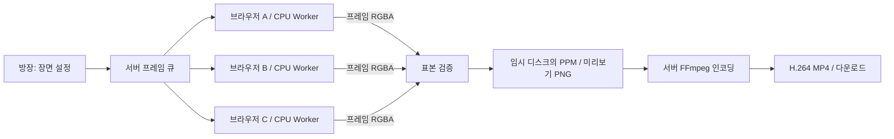

# TabCloud 브라우저 엣지 렌더팜

여러 브라우저가 내장 3D 장면의 서로 다른 프레임을 CPU Web Worker로 계산한다. 서버는 방·작업 배정·표본 검증·프레임 저장·최종 MP4 인코딩을 담당한다. 입력은 작은 장면 설정과 프레임 번호이며, 사용자 동영상 업로드나 임의 프로그램 실행은 지원하지 않는다.

## 실행과 시연

`pnpm install --frozen-lockfile` 후 `pnpm dev`를 실행하고 `http://localhost:5173`에서 방을 만든다. 영상 인코더 `ffmpeg-static`은 의존성 설치 시 운영체제에 맞는 실행 파일을 내려받는다. 별도 FFmpeg를 사용할 때는 서버의 `FFMPEG_PATH`를 해당 실행 파일의 절대 경로로 지정한다.

1. **미리보기**로 설치와 영상 재생을 먼저 확인한다.
2. **720p 시연**을 선택하고 초대 링크를 다른 기기에 연다. 기기 3대 시연에서는 처음부터 서버의 LAN 주소로 방을 만든다. `localhost` 링크는 다른 기기를 가리키지 않는다.
3. 각 기기에서 **연산 참여**를 누르고 방장에서 **렌더 시작**을 누른다. 방장은 관찰만 할 수도 있다.
4. 완료 프레임과 기기별 기여도를 확인한다. 작업 중 한 기기의 **연산 중단** 또는 탭 종료로 재배정을 시연한다.
5. 프레임 렌더링 후 서버 인코딩이 끝나면 완성 영상을 재생하고 **영상 다운로드**로 MP4를 저장한다.

| 프리셋 | 해상도 | 프레임 / 길이 | 픽셀당 샘플 | 반사 한도 |
| --- | --- | --- | --- | --- |
| 미리보기 | 320×180 | 24 / 1초 | 2 | 2 |
| 720p 시연 | 1280×720 | 120 / 5초 | 8 | 3 |
| 고화질 | 1280×720 | 240 / 10초 | 16 | 3 |

영상은 24fps다. 모든 프리셋은 실제 광선·교차·그림자·반사·샘플 계산으로 부하를 만든다. 인위적 지연이나 가짜 진행률을 사용하지 않는다. **직접 설정**에서 해상도·프레임·샘플·반사 수를 변경할 수 있다. 한 브라우저는 Worker 1개만 사용하고 언제든 중단할 수 있다.

## 계산과 저장 흐름

프레임 단위 pull 배정으로 빠른 기기가 더 많은 프레임을 처리한다. 각 시도는 별도 attempt ID를 갖고, 승인된 프레임만 완료 수에 포함한다. 증가하는 행 진행 보고는 lease를 갱신하고, heartbeat는 기기의 연결 상태를 확인한다. 참여 철회·연결 유실·시간 초과로 회수된 프레임은 다른 참여자에게 배정된다.

장면·애니메이션 시간·픽셀·샘플 난수는 결정적으로 계산한다. 서버는 전체 프레임을 대신 그리지 않고 소수 픽셀만 재계산하여 형식·시도·결과를 확인한다. 표본 검증은 악의적인 노드에 대한 완전한 무결성 증명이 아니다. 자동 테스트는 작은 프레임 전체를 기준 렌더러와 비교한다.

한 번에 한 프레임 버퍼만 Worker에서 계산하고 소유권을 UI에 이전해 바이너리로 업로드한다. 서버는 결과를 PPM 파일로 저장하며 전체 영상을 RAM에 보관하거나 모든 참가자에게 방송하지 않는다. UI는 작은 PNG 미리보기와 작업 메타데이터만 갱신하고, 완료된 MP4를 요청한다. PPM·영상 파일은 새 작업, 취소, 방 정리, 정상 서버 종료에 맞춰 제거한다. 서버가 비정상 종료되면 OS 임시 경로에 잔여 파일이 남을 수 있다.

영상 저장소는 한 프로세스의 임시 디스크다. 최대 720p·240프레임, 동시에 렌더링·인코딩 중인 작업 2개, 완료 결과를 포함한 전체 예약 1500MiB 제한을 적용한다. 720p·240프레임의 RGB 본문은 약 664MB이며, 썸네일과 최종 영상 공간이 추가된다. 저장소 용량이 넉넉한 기기에서 시연한다. 이 예산은 프로세스 메모리 제한이나 장기 스토리지 서비스와 다르다. 작업 제한은 30분이며 한 프레임의 시도 제한은 기본 120초다.

## 시간과 성능 해석

- 렌더 시간: 서버가 작업을 시작한 시점부터 마지막 프레임 승인까지. 참여자를 기다리는 시간과 전송도 포함한다.
- 인코딩 시간: 받은 프레임을 최종 MP4로 만드는 서버 단계.
- 전체 시간: 시작부터 영상 파일 완성까지. 다운로드와 사용자의 재생 대기는 포함하지 않는다.
- 기기 계산 시간 합계는 병렬 실행 구간이 겹치므로 전체 시간과 다르다.

한 기기와 여러 기기를 비교할 때는 해상도·프레임·샘플·반사 수를 동일하게 맞추고 두 경우 모두 최종 인코딩을 포함한다. 같은 PC의 여러 탭은 프로토콜·기여도 검증에 유용하지만 물리적 여러 기기의 가속률을 증명하지 않는다. 렌더가 가벼우면 네트워크·작업 요청·인코딩 비용 때문에 분산 쪽이 느릴 수 있다.

## 범위와 파일

기본 화면은 `/`, 영상 방은 `/studio/:id`다. 기존 프랙털은 `/fractal`과 `/room/:id`에 보존했다. 영상 모드의 API는 인증된 HTTP polling·바이너리 업로드로 동작하고, 기존 프랙털 모드의 WebSocket과 별도다. 브라우저 WebCodecs나 GPU를 요구하지 않으며 서버 인코더가 MP4를 만든다. 오디오는 없다.

- `packages/compute/src/animation.ts`: 내장 3D 렌더러
- `packages/shared/src/animation.ts`: 설정·프레임·상태 타입과 제한
- `apps/server/src/animation*.ts`: 작업 관리·인증·디스크·인코딩
- `apps/web/src/AnimationApp.tsx`, `animation.worker.ts`: UI와 실제 Worker
- `tests/e2e/animation.spec.ts`: 실제 다중 브라우저·MP4 테스트

정확한 엔드포인트와 응답 형식은 [구현 계약](ANIMATION_CONTRACT.md)을 참조한다. 공용 인터넷 배포에서는 HTTPS와 운영 환경에 맞는 스토리지·인증·관찰 도구가 추가로 필요하다. FFmpeg 실행 파일은 해당 배포의 라이선스를 따르며 TabCloud의 자체 소스 라이선스와 구분된다.
