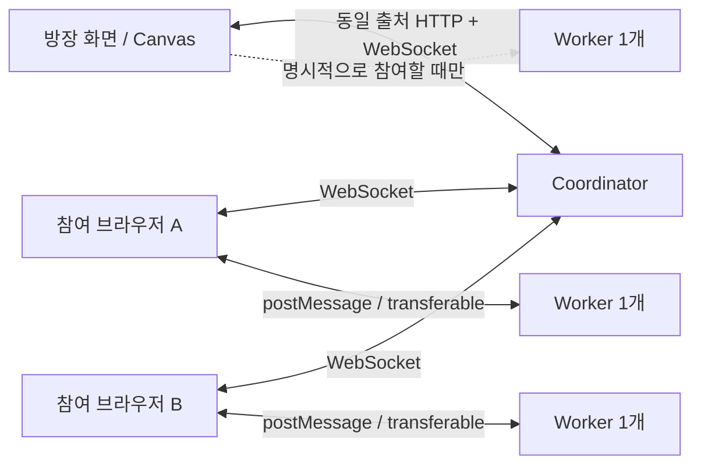
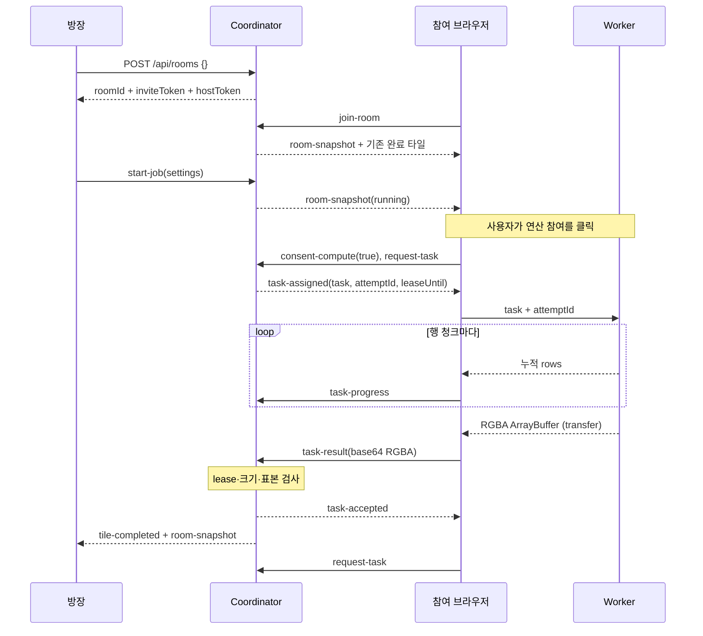
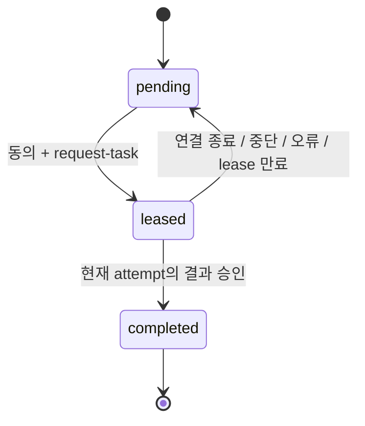

# TabCloud MVP 아키텍처

이 문서는 `/fractal`의 기존 프랙털 엔진을 설명한다. 기본 홈페이지의 3D 영상 렌더팜은 [영상 아키텍처와 시연](ANIMATION.md)을 참조한다.

TabCloud Render는 브라우저가 Mandelbrot 픽셀을 계산하고, 단일 Node.js Coordinator가 방·할당·재시도·결과 전달을 관리하는 인메모리 시스템이다. 서버는 승인할 타일의 소수 픽셀만 재계산하며 전체 이미지를 대신 렌더링하지 않는다.

## 1. 코드와 데이터 흐름

| 위치 | 역할 |
| --- | --- |
| `apps/web` | React 화면, WebSocket 연결, 동의·중단, Canvas 합성, PNG, 단독 측정 |
| `apps/web/src/render.worker.ts` | 브라우저 Worker 1개에서 타일 계산, 행 단위 진행 알림 |
| `apps/server` | Fastify HTTP API, `ws` 연결, 권한, 작업 큐, lease, 표본 검증, 자원 제한 |
| `packages/shared` | Zod 런타임 스키마, 프로토콜 타입, 설정·메시지 제한 |
| `packages/compute` | 동일하게 재사용하는 결정적 픽셀 계산, 타일 분할·병합, 체크섬 |



개발 환경은 Vite의 `/api`, `/healthz`, `/ws` 프록시를 사용한다. 빌드 후에는 서버가 정적 웹과 API·WebSocket을 같은 출처에서 제공한다. 서버를 여러 개 띄워도 방 상태는 공유되지 않는다.

## 2. 방과 권한

`POST /api/rooms`에 빈 JSON 객체 `{}`를 보내면 `201`과 다음 값을 받는다.

```json
{
  "roomId": "cryptographically-random-room-id",
  "inviteToken": "cryptographically-random-invite-token",
  "hostToken": "separate-private-host-token",
  "expiresAt": 1791648000000
}
```

위 값은 형식 설명용 예시다. 실제 값은 서버가 암호학적 난수로 생성한다. 초대 URL은 `/room/{roomId}#invite={inviteToken}`이며, 방장 토큰은 해당 탭의 `sessionStorage` 키 `tabcloud:host:{roomId}`에 저장한다. 초대 링크에 방장 토큰을 넣지 않는다. URL fragment는 일반 HTTP 경로에 포함되지 않지만, 방 참가 시 브라우저가 초대 토큰을 WebSocket 메시지로 보낸다. 링크를 가진 사람은 참여할 수 있으므로 공개 채널에 올릴 때 범위를 판단해야 한다.

방장 여부는 서버가 별도 방장 토큰으로 확인한다. 화면 버튼을 숨기는 것만으로 권한을 통제하지 않는다. 시작·취소는 방장만 가능하고, 계산 참여는 역할과 별개다. 방장은 Worker 없이 관찰·관리만 해도 된다.

방과 결과는 메모리에만 존재한다. 서버 재시작, 방 만료, 모든 연결이 사라진 뒤 유휴 정리로 소멸한다. 기본 수명은 생성 후 1시간이고, 유휴 정리는 10분이다. 참가 중인 연결이 있어도 절대 수명은 연장되지 않는다. 새 작업을 시작하면 이전 작업의 결과를 대체한다. 재시작하거나 만료된 방의 링크로 영구 복구할 수 없으며 새 방을 만들어야 한다.

## 3. 메시지 규약

WebSocket 경로는 `/ws`, 메시지는 JSON, 프로토콜 버전은 `v: 1`, 알고리즘 버전은 `mandelbrot-v1`이다. 클라이언트 입력은 `clientMessageSchema`, 브라우저가 받는 메시지는 `serverMessageSchema`로 검증한다. 알 수 없는 필드는 허용하지 않는다. 전체 필드는 [구현 규약](IMPLEMENTATION_CONTRACT.md)과 `packages/shared/src/index.ts`를 기준으로 한다.

| 방향 | 메시지 | 주요 내용 |
| --- | --- | --- |
| C → S | `join-room` | 방 ID, 초대 토큰, 선택적 방장 토큰, 표시명 |
| C → S | `consent-compute` | `enabled: true/false`; 연결 자체는 동의가 아님 |
| C → S | `start-job`, `cancel-job` | 검증된 렌더 설정 또는 취소할 job ID; 방장 전용 |
| C → S | `request-task` | 동의한 클라이언트의 다음 타일 요청 |
| C → S | `task-progress` | job/task/attempt ID, 완료한 누적 행 수 |
| C → S | `task-result` | job/task/attempt ID, base64 RGBA, 클라이언트 측 `computeMs` |
| C → S | `task-error` | 할당 ID와 최대 200자 오류 설명 |
| C → S | `heartbeat`, `leave-room` | 연결 생존 확인 또는 명시적 퇴장 |
| S → C | `room-snapshot` | 방·참가자·현재 작업·제한된 이벤트 기록, 수신자 ID·역할 |
| S → C | `task-assigned` | TileTask, 새 `attemptId`, `leaseUntil` |
| S → C | `task-accepted`, `task-rejected` | 특정 시도 승인 또는 거절 |
| S → C | `tile-completed` | 승인된 타일·픽셀과 기여자 ID |
| S → C | `job-cancelled`, `error`, `heartbeat-ack` | 취소·오류·생존 확인 응답 |



타일은 `{jobId,taskId,x,y,width,height,settings,algorithmVersion}` 구조다. 예를 들어 기본 작업 첫 타일의 좌표는 `(0,0)`, 크기는 `128×128`, RGBA 데이터는 65,536바이트다. Worker → UI 경계에서는 ArrayBuffer를 소유권 이전하여 복사를 줄인다. UI → 서버 경계에서는 표준 base64로 인코딩하며 최대 87,384문자다. 전체 WebSocket 메시지는 최대 98,304바이트다. 서버는 해당 lease가 요구하는 정확한 디코딩 바이트 수까지 검사한다.

새로 참가하거나 재연결하면 현재 snapshot 이후 이미 완료된 타일을 받는다. 브라우저는 현재 `jobId`와 수신한 `taskId` 집합으로 중복 합성을 막는다. 새 job ID에서는 Canvas와 수신 집합을 초기화한다. PNG는 서버 상태가 `completed`이고 해당 브라우저가 모든 타일을 수신했을 때만 제공한다. 느린 수신자로 인해 출력 버퍼가 한도를 넘으면 연결을 정리하며, 이후 재접속으로 상태를 다시 받을 수 있다.

## 4. 상태 머신과 재할당



각 참가자는 최대 1개 활성 lease만 가진다. 완료가 빠른 브라우저가 다음 타일을 요청하는 pull 방식이다. 빈 큐를 확인한 대기 클라이언트는 실행 중에 약 500ms마다 요청한다. 서버는 대기 요청을 기억하여 큐가 다시 생길 때 배정할 수 있다. 동의하지 않았거나 현재 lease를 가진 연결에는 추가 작업을 주지 않는다.

전체 작업 상태는 `created / running / completed / cancelled / failed`다. `created`는 프로토콜에 정의된 준비 상태이고, 정상적인 시작 요청은 작업을 생성하여 바로 `running`으로 전환한다. 유효하게 승인된 고유 타일 수가 전체 수와 같으면 `completed`가 된다. 방장이 취소하면 `cancelled`, 재시도·시간 제한을 넘으면 `failed`가 되며 실패 이유가 snapshot에 포함된다. 종료 상태에서는 새로운 lease를 발급하지 않는다.

연결 heartbeat와 계산 진행은 별도로 다룬다.

| 정책 | 기본값과 동작 |
| --- | --- |
| 클라이언트 heartbeat | 5초 간격 |
| 서버 heartbeat timeout | 20초 동안 생존 확인이 없으면 연결 정리 |
| 초기 lease | 15초 |
| 진행 기반 lease 연장 | 현재 attempt의 완료 행 수가 엄격히 증가할 때 연장 |
| 한 attempt의 절대 상한 | 최초 배정부터 120초; 진행 알림으로 무한 연장 불가 |
| 타일 재시도 | 최초 시도 후 최대 5회 추가 시도 |
| 전체 작업 제한 | 시작 후 10분 |
| 정리 검사 간격 | 1초; timeout 처리는 검사 간격만큼 늦어질 수 있음 |

heartbeat만 계속 보내도 멈춘 타일의 lease가 연장되지는 않는다. 동일하거나 감소한 `rows`, 다른 task/attempt의 알림도 진행으로 인정하지 않는다. 정상 Worker는 8행 단위로 진행을 보내고 청크 사이에 이벤트 루프를 양보한다. 연결 종료 또는 동의 철회는 활성 lease를 회수하고 해당 타일을 재할당한다. 옛 `attemptId`, 완료된 타일의 중복 결과, 다른 참가자의 lease 결과는 완료 수를 늘리거나 이미 승인된 이미지를 덮어쓸 수 없다.

사용자가 `연산 중단`을 누르면 브라우저는 Worker를 즉시 `terminate()`하고 동의를 철회한다. 연결 상실·취소·실패·화면 종료 때도 연산을 멈춘다. 재연결은 지수형 지연을 사용하며 다시 연결되어도 자동으로 동의하지 않는다. 사용자가 `연산 참여`를 다시 눌러야 한다. 탭이 숨겨지거나 기기가 절전 상태이면 브라우저 스케줄링이 느려질 수 있다.

## 5. Mandelbrot의 결정적 정의

공용 엔진의 기준 설정은 `1024×1024`, 타일 `128`, 최대 반복 `500`, 중심 `(-0.5,0)`, 가로 범위 `3.5`다. 웹의 새 방 기본값은 시연용 `2048×2048 / 8,000회`이며, 가볍게(기준 설정)와 최대 부하(`2048×2048 / 20,000회`)도 선택할 수 있다. 프리셋은 같은 엔진의 입력만 변경하며 동시 Worker는 1개다. 세로 범위는 `span × height / width`로 정하여 정사각형 픽셀을 유지한다.

0부터 시작하는 이미지 좌표 `(x,y)`에서 복소수 `c`의 좌표는 다음과 같다.

```text
real      = centerX + ((x + 0.5) / width  - 0.5) × span
imaginary = centerY + ((y + 0.5) / height - 0.5) × span × height / width
z₀ = 0
zₙ₊₁ = zₙ² + c
```

`|z|² > 4` 또는 최대 반복에 도달할 때 멈춘다. 최대 반복에 도달한 내부 픽셀은 RGBA `(9,14,27,255)`다. 외부 픽셀은 탈출 반복 횟수를 고정된 16개 정수 RGB 팔레트의 인덱스로 사용하며 알파는 항상 `255`다. 로그·삼각함수 기반 보간을 사용하지 않는다. 팔레트, 연산 순서, 좌표 규칙을 바꿀 때는 알고리즘 버전을 변경해야 한다. 연산은 JavaScript 배정밀도 부동소수점이며 임의 정밀도 딥줌은 지원하지 않는다.

타일은 행 우선으로 나누며 오른쪽·아래쪽의 남는 픽셀도 작은 타일로 포함한다. `mergeTile`은 원본 이미지 좌표에 각 행을 복사하고 버퍼 길이 불일치를 거부한다. 단독 실행과 분산 실행은 같은 코드·설정·타일 정의를 사용한다. `checksum`은 RGBA 바이트에 대한 FNV-1a 32비트 8자리 16진 문자열이다. 오류 비교를 위한 값이며 충돌 저항성이나 인증을 제공하지 않는다. 전체 픽셀 비교 테스트가 체크섬 비교를 보완한다.

| 설정 | 허용 범위 |
| --- | --- |
| 너비·높이 | 각각 정수 64–2048 |
| 전체 픽셀 | 최대 4,194,304, RGBA 원본 최대 16 MiB |
| 타일 크기 | 32 / 64 / 128 |
| 타일 수 | 최대 4096 |
| 최대 반복 | 정수 10–20000 |
| 중심 X·Y | 각각 -4–4 |
| 가로 범위 | 0.000001–8 |

모든 숫자는 유한해야 하며 문자열 숫자, `NaN`, 무한대, 알 수 없는 설정 필드를 허용하지 않는다.

## 6. 검증과 운영상 신뢰 경계

서버는 클라이언트의 역할·동의·소유 lease·attempt·타일 범위·페이로드 크기를 확인하고 최대 8개 표본을 `renderPixel`로 재계산한다. 일반 타일에서는 첫 픽셀·마지막 픽셀 및 암호학적 난수로 고른 서로 다른 6개 위치를 검사하며, 경계의 작은 타일이 8픽셀 미만이면 모든 픽셀을 검사한다. 일치하지 않는 결과는 승인하지 않는다. 이 검사로 전체 타일의 무결성을 증명할 수는 없다. 표본 밖의 오류·악의적인 변조가 통과할 수 있으며, 공개된 비신뢰 노드를 위한 합의·다중 독립 재계산·암호학적 검증은 MVP 범위 밖이다.

내장된 Mandelbrot 코드만 실행하며 사용자가 제출한 임의 코드는 실행하지 않는다. 파일·카메라·마이크 접근 권한을 요구하지 않는다. 이름은 가명으로 표시하며 방장 자격과 초대 토큰을 URL·로그·분석 서비스로 불필요하게 내보내지 않아야 한다.

서버 기본 자원 제한은 다음과 같다. 배포 시 환경변수로 조정할 수 있으며 실제 키와 검증은 `apps/server/src/config.ts`를 기준으로 한다.

| 자원 | 기본 한도 |
| --- | --- |
| 방 수 / 전체 WebSocket 연결 | 32 / 256 |
| 한 방의 연결 참가자 / 참가자 이력 | 24 / 64 |
| 작업 메모리 예약 / 전체 결과 예약 | 24 MiB / 128 MiB |
| 예약 계산 | base64 최악 크기 + 타일당 메타데이터 여유 1024바이트 |
| 연결별 메시지 | 초당 250개 |
| 방 생성 | 서버가 관찰한 IP당 분당 10개 |
| 연결별 송신 버퍼 | 2 MiB |

설정 스키마를 통과해도 메모리 예약이 가득 차면 작업 시작이 거절될 수 있다. 예를 들어 `2048×2048 / 타일 32`는 타일 메타데이터까지 합쳐 기본 작업 예약 한도 24 MiB를 초과한다. 이 해상도에서는 타일 64 또는 128을 사용한다. 필요에 따라 운영자가 작업 한도를 조정할 수 있으나 전체 한도와 실제 프로세스 메모리를 함께 고려해야 한다.

예약 한도는 Node.js 프로세스의 실제 RSS 상한과 같지 않다. JSON 문자열·객체·소켓·순간적인 복사·브라우저 버퍼에도 메모리가 필요하다. 인메모리 단일 프로세스와 제한된 이력을 전제로 운영한다. WebSocket은 Origin을 필수로 확인하고 같은 Host의 HTTP(S) origin 또는 `PUBLIC_ORIGIN` 허용 목록을 적용한다. HTTP API는 CLI 사용을 위해 Origin 없는 요청도 허용한다. 공개 배포는 HTTPS/WSS와 적절한 리버스 프록시가 필요하다.

## 7. 측정값 해석

| 값 | 실제 의미 |
| --- | --- |
| 분산 실행 · 화면 완성 | 작업을 시작한 방장 브라우저의 `performance.now()` 기준으로 시작 메시지 전송 직전부터 모든 타일 합성 후 다음 animation frame까지 |
| 서버 `wallMs` | 서버의 작업 시작부터 모든 타일 승인까지; 마지막 전송·화면 표시 지연은 제외 |
| 단독 실행 | 같은 브라우저에서 Worker 1개를 만들기 전부터 모든 타일 계산·Canvas 합성·체크섬 완료까지 |
| `computeMs` | 승인된 각 타일의 클라이언트 보고 시간 합계; Worker 양보 대기 포함, 순수 CPU 시간이나 신뢰된 계측값이 아님 |
| `validationMs` | 서버에서 측정한 결과 검증 시간 |
| `roundTripMs` | 서버가 측정한 각 할당→결과 수신 시간의 합; 여러 기기 구간이 겹침 |
| `resultBytes` | 승인된 RGBA 바이트 합; base64 팽창·JSON·WebSocket 헤더·재전송·방송 데이터 제외 |

속도 비율은 호스트의 화면 완성 시간이 있을 때 `단독 wall-clock / 분산 화면 완성 wall-clock`으로 표시한다. 새로 참가한 관찰자나 연결이 끊긴 뒤 복구된 방장은 원래 로컬 시작 시계를 복원할 수 없어 이 값과 비율을 제공하지 않는다. 서버 측 시간은 별도로 볼 수 있다. `requestAnimationFrame`은 브라우저 표시 시점의 근사값이며 디스플레이의 실제 픽셀 전환 시각을 측정하지 않는다.

`roundTripMs - computeMs`를 전체 wall-clock 통신 오버헤드라고 해석하면 안 된다. 병렬 구간 중첩, 브라우저 스케줄링, 직렬화·전송, 서버 대기와 검증이 섞여 있다. 한 컴퓨터의 여러 탭은 CPU·메모리·네트워크를 공유하므로 여러 물리적 컴퓨터의 속도 향상을 입증하지 않는다. 실제 비교 절차는 [DEMO.md](DEMO.md)를 따른다.
